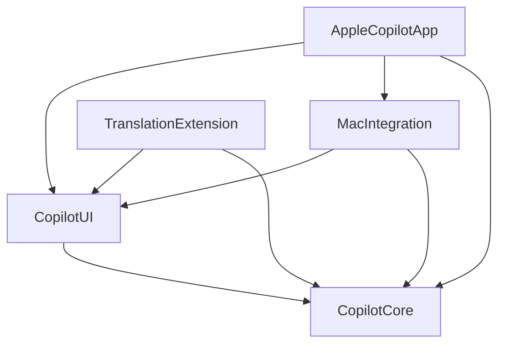

# 架构

Apple Copilot 使用 MV + Observation。领域状态、网络、密钥和持久化通过可替换依赖组织；视图负责布局、导航和短暂的输入/滚动状态。当前复杂度没有引入额外 ViewModel、Reducer 或第三方架构框架的必要。

## 模块与依赖方向

| 模块 | 主要职责 | 不承担的职责 |
| --- | --- | --- |
| `CopilotCore` | Sendable 领域值、协议适配、URLSession、Keychain、文件仓库、MainActor stores | 页面导航、SwiftUI 布局 |
| `CopilotUI` | 翻译、历史、设置与富文本展示；共享环境和键盘动作 | 服务商 SDK、签名、系统扩展生命周期 |
| `AppleCopilotApp` | 主窗口、平台生命周期和 Mac 菜单 | 网络与存储策略 |
| `TranslationExtension` | TranslationUIProvider 上下文和宿主动作适配 | 自行改变默认翻译设置 |
| `MacIntegration` | AppKit Services 和原生 NSPanel | iOS 扩展协议 |

所有共享代码通过根目录 Swift Package 构建。Xcode 工程只管理应用入口、扩展、图标和平台签名配置；`project.yml` 是工程来源。

## 核心文件边界

- `Models.swift`：会话和消息值类型，保留现有 Codable 文件结构。
- `ProviderConfiguration.swift`：协议选择、端点解析、配置与凭据身份。
- `PromptTemplate.swift`：命名变量的一次性替换、文字转义和请求上下文。
- `LanguageModelClient.swift`：可注入模型客户端与请求编排。
- `ModelProtocolAdapter.swift`：三种协议的请求构造和完整 JSON 回复解码。
- `ModelStreamDecoder.swift`：SSE 分帧及协议事件解码，独立于 TCP 分块和 UTF-8 边界。
- `HTTPTransport.swift`：可注入 HTTP 接口与不跟随重定向的临时 URLSession。
- `Credentials.swift`：Keychain、内存凭据及共享密钥校验。
- `Repositories.swift`：仓库协议、会话合并和历史筛选规则。
- `FileRepositories.swift` / `FileRepositorySupport.swift`：文件仓库、跨进程锁和原子写入。
- `MemoryRepositories.swift` / `PreviewFixtures.swift`：确定性测试与预览依赖。
- `SettingsStore.swift` / `ConversationStore.swift`：业务状态所有者。

## 状态所有权

| 所有者 | 状态与操作 |
| --- | --- |
| `SettingsStore` | 可编辑配置、密钥草稿、已保存快照、载入/保存状态、草稿校验与保存条件 |
| `ConversationStore` | 当前会话、历史、请求状态、待发送消息、流式临时输出、取消和错误 |
| `CopilotEnvironment` | 依赖组合、主会话、共享初始化 Task、导航分区与工作区草稿 |
| SwiftUI 视图 | 焦点、滚动跟随、选择、删除确认、复制反馈与临时展示状态 |

Stores 在 MainActor 上修改可观察状态，仓库和凭据实现使用 actor 隔离。跨并发边界的数据和协议标记为 Sendable。导航不进入核心模块。

`SettingsStore` 同时维护草稿和已保存快照；翻译只读取已保存配置。刷新共享设置时不会覆盖正在编辑的草稿。Keychain 的身份由协议与最终端点组成，不包含模型、提示词或语言。修改服务时不能借用原服务密钥；同一根地址和完整端点会解析为同一身份。

`CopilotEnvironment.load()` 共享正在运行的初始化 Task。系统入口在读取新选区前等待初始化、刷新共享设置并检查取消，再创建独立会话 store。Mac 主窗口和 Services 窗口共享设置与仓库，不共享进行中的会话。

## 请求生命周期

1. 清理输入，取已保存配置快照，创建待发送 user 消息。
2. 按端点身份获取密钥，构建带完整上下文的协议请求。
3. 使用临时 URLSession 接收 SSE，解码器只发布可见文本，忽略 reasoning 和工具参数。
4. `ConversationStore` 首个增量立即发布，后续约每 50 ms 合并发布。流式内容保持在临时消息中。
5. 检测完整结束且文本非空后，原子保存 user/assistant 消息对；成功存储后才更新持久会话和历史。

取消与切换会话会使 generation token 失效；迟到的响应不能覆盖新选择。停止或失败时保留当前页面收到的部分回复供阅读和复制，不写入历史，也不放入后续模型上下文。重新请求或切换会话会清除临时输出。仓库保存失败不发布成功状态。

普通 JSON 兼容回复也可以通过流式请求返回，不会再发送第二次请求。HTTP 错误只显示安全状态码与本地说明，不显示可能回显凭据或原文的服务端 body。

## 持久化与进程共享

iOS 主应用和翻译扩展共享 App Group 内的配置和历史，以及同一 Keychain access group。Mac Services 位于主应用进程。没有跨设备同步。

配置保存在 `settings.json`，会话保存在 `Conversations/<UUID>.json`。锁文件串行化同一容器的读取、合并和写入，JSON 使用原子写入。会话按消息 UUID 合并，配置或原文冲突会报错；删除建立 tombstone，防止其他进程的迟到请求重新创建记录。当前历史查询逐文件解码；损坏文件会报告存储错误，大规模历史索引和损坏文件隔离尚未实现。

新增字段需要保持旧文件解码兼容，并提供迁移或默认值。整理文件名和格式不改变已有存储格式。

## UI 与平台边界

`CopilotUI` 按 `Translation/`、`History/`、`Settings/`、`Markdown/` 分组。共享追问容器保持稳定的输入视图身份；原生 AppKit/UIKit 编辑器处理输入法组合、粘贴和键盘提交。

`HistoryView` 拥有选择和详情生命周期，`HistorySidebar` 展示工作区侧栏，行组件只读取会话。设置页面读取核心模型的校验结果；独立 section 负责表单布局，`SettingsEditor` 负责返回与未保存修改确认。

SwiftUI 拥有消息结构及纵向滚动，WebKit 拥有每条回复的本地 DOM 排版。`RichMarkdownView` 负责语义外观与测量结果，`MarkdownWebView` 负责桥接和生命周期，`MarkdownImageLoader` 负责用户明确请求的图片下载。资源、字体和依赖 notice 随 Swift Package 分发。详见 [富文本渲染](RICH_TEXT_RENDERING.md)。

iOS/iPadOS 宿主负责系统翻译弹窗的标题、关闭和替换能力。macOS 使用 Services 和自有 NSPanel；没有第三方系统 Translate sheet 接口。详见 [系统集成](PlatformIntegration.md)。

## 测试边界

模型客户端、HTTP transport、凭据和仓库都可注入。核心测试覆盖协议、端点身份、SSE 边界、状态转换、取消、失败及持久化；原生 Mac 测试覆盖 WebKit、输入法和键盘/滚轮行为。本机 fixture 测试使用真实 URLSession，但不访问远程模型。预览使用内存依赖，不读生产数据。当前验证和设备限制见 [验证说明](VALIDATION.md)。
