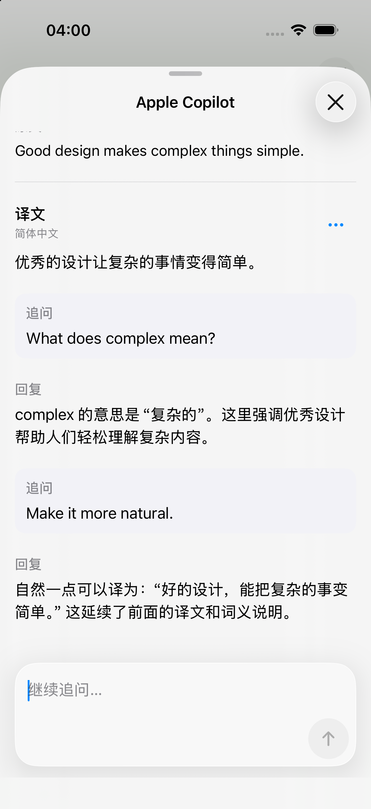
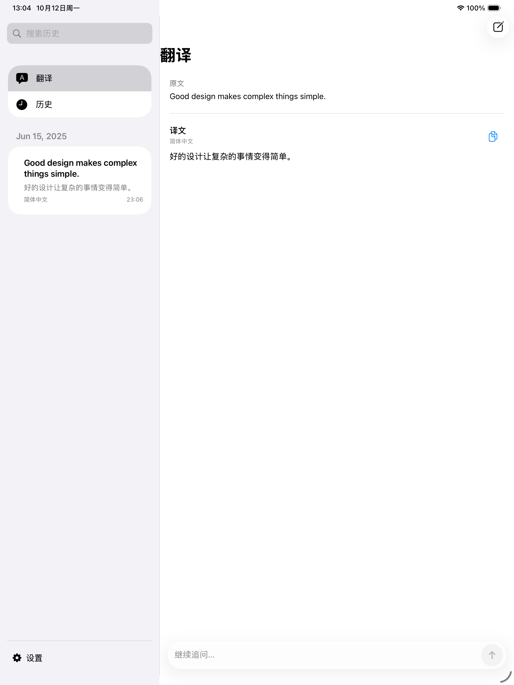
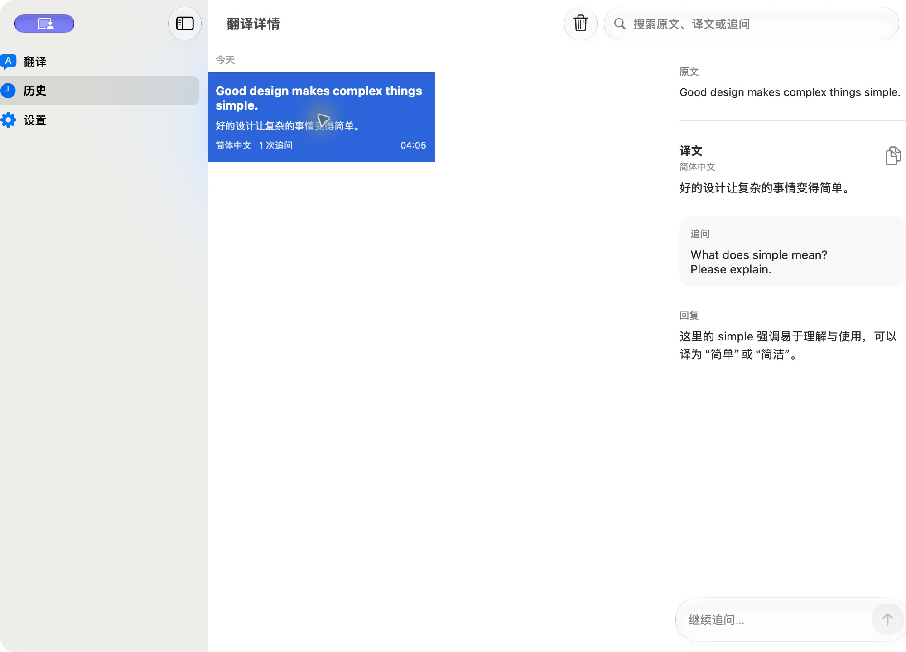

# Apple Copilot

[English](README.en.md) · [文档](Docs/README.md) · [贡献指南](CONTRIBUTING.md)

原生 SwiftUI 翻译应用，支持 **iOS 26、iPadOS 26 和 macOS 26**。使用自己的模型服务和 API key，完成翻译、连续追问和本地历史检索。

项目处于早期开发阶段，目前通过源码构建运行。界面主要使用中文，尚未提供完整多语言本地化。

## 功能

- **自带模型服务（BYOK）**：支持 OpenAI Chat Completions、OpenAI Responses 和 Anthropic Messages 协议，以及兼容这些协议的服务。
- **流式翻译与追问**：保留完整会话上下文，支持停止、失败重试和草稿恢复；历史会话保留创建时的配置快照。
- **可配置提示词**：自定义目标语言和翻译系统提示词，支持语言、模型、日期和会话变量。
- **富文本回复**：Markdown、代码高亮与复制、表格、公式、脚注和 Mermaid；渲染资源离线打包，远程图片由用户主动加载。
- **本地历史与密钥**：每段会话独立保存为 JSON，API key 存入设备 Keychain；iOS 主应用和扩展共享同一设备上的数据。
- **系统入口**：iPhone/iPad 使用 Translation Provider Extension；Mac 使用系统 Services 和原生浮动窗口。

| iPhone 系统翻译 | iPad 工作区 | Mac 会话 |
| --- | --- | --- |
|  |  |  |

截图来自开发版本。当前验证范围见 [验证说明](Docs/VALIDATION.md)。

## 快速开始

需要 macOS 和完整 Xcode。当前验证工具链为 **Xcode 27 / Swift 6.4**；Swift Package 声明的最低工具版本为 Swift 6.2。目标系统最低为 iOS/iPadOS/macOS 26，尚未完成更早 Xcode 工具链的兼容验证。

```sh
git clone https://github.com/Lakphy/apple-copilot.git
cd apple-copilot
open AppleCopilot.xcodeproj
```

选择 `AppleCopilot-macOS` 或 `AppleCopilot-iOS` scheme。iOS scheme 同时支持 iPhone 和 iPad，并嵌入翻译扩展。生成后的工程已提交，普通构建不需要 XcodeGen 或 Node.js。

启动后进入“设置”，填写协议、Base URL、服务商提供的模型 ID 和 API key，保存后开始翻译。地址可以填写 API 根地址、版本路径或完整端点；设置会显示最终请求地址。服务与模型是否可用取决于对应服务商。

真机运行需要自己的开发者 Team、Bundle ID、App Group 与共享 Keychain 配置，并需要该团队支持默认翻译应用能力。项目不绑定个人 Team；本地签名配置不进入版本库。具体步骤见 [安装与使用](Docs/GETTING_STARTED.md)。

### 系统翻译

- **iPhone/iPad**：在系统“设置 → App → 默认 App → 翻译”选择 Apple Copilot，然后在支持的 App 中选中文字并选择“翻译”。
- **Mac**：选中文字，打开“服务 → 使用 Apple Copilot 翻译”；若未显示，在系统“键盘 → 键盘快捷键 → 服务”启用。需要运行完整 `.app` bundle。

macOS 的公开接口没有第三方系统 Translate sheet，本项目的 Mac 入口是应用提供的 Services 窗口。历史不跨设备同步，当前仅支持文本模型请求。

## 开发与验证

```sh
# 完整 Swift 测试，自动启动并清理本机模型测试服务
./Scripts/test.sh

# 风格、文档链接、配置检查、全部 Swift 测试、Mac 和 iOS Simulator 构建
./Scripts/check.sh
```

若要修改 Markdown 引擎，需要 Node.js 22+ 和 npm：

```sh
cd Scripts/MarkdownRenderer
npm ci --ignore-scripts
npx playwright install webkit
cd ../..
./Scripts/check-markdown.sh
```

Swift 源码使用仓库的 `.swift-format` 配置。`project.yml` 是 Xcode 工程来源；修改它后运行 `xcodegen generate`，并提交生成结果。更多命令和测试边界见 [开发指南](Docs/DEVELOPMENT.md)。

## 仓库结构

| 路径 | 职责 |
| --- | --- |
| `Sources/CopilotCore/` | 配置、会话、协议适配、HTTP、存储和可观察状态 |
| `Sources/CopilotUI/` | 共享 SwiftUI 页面；按 Translation、History、Settings、Markdown 分组 |
| `Sources/AppleCopilotApp/` | 应用生命周期、窗口和菜单 |
| `Sources/TranslationExtension/` | iOS/iPadOS 系统翻译扩展 |
| `Sources/MacIntegration/` | macOS Services 和浮动窗口 |
| `Tests/` | 核心行为测试与原生 Mac 组件测试 |
| `Configuration/` | Info.plist、entitlements 和签名配置示例 |
| `Scripts/` | 检查、构建、渲染资源生成和本机测试服务 |
| `Docs/` | 使用、架构、隐私、验证及历史设计记录 |

应用采用 MV + Observation，通过依赖注入测试网络和存储边界。架构细节见 [架构文档](Docs/ARCHITECTURE.md)。

## 隐私与许可

翻译和追问会将原文、系统提示词及本会话上下文发送给你配置的服务。历史只保存在本地，密钥不写入历史或日志；模型服务的数据处理由对应服务商决定。详见 [数据与隐私](Docs/PRIVACY.md)。

原创应用代码、工具与文档采用 [MIT](LICENSE)。打包的渲染库、字体和仓库内开发技能保留各自上游许可，详见 [第三方声明](THIRD_PARTY_NOTICES.md)。开发技能不是应用依赖；其中 Apple 设计技能包的分发授权仍待核实，不能把整个仓库视为全部采用 MIT。

Apple Copilot 是独立项目，与 Apple 及模型服务商无隶属或背书关系。欢迎通过 Issue 和 Pull Request 参与；安全问题请参阅 [安全报告方式](SECURITY.md)。
